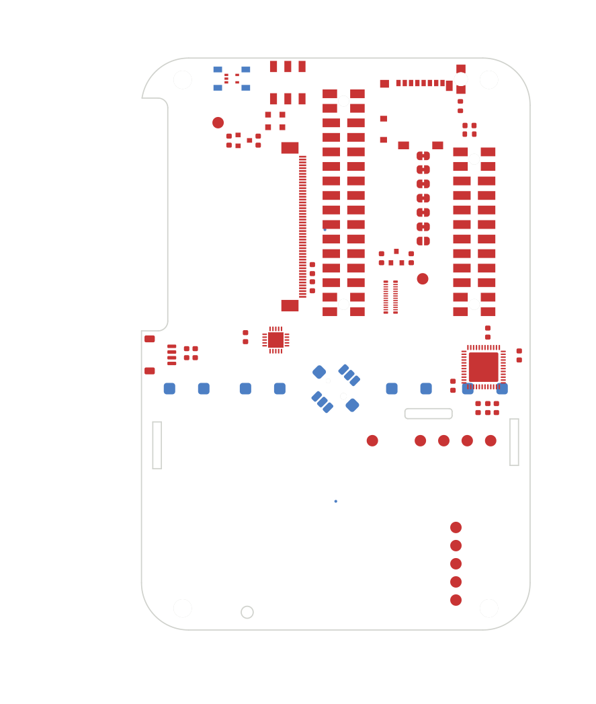
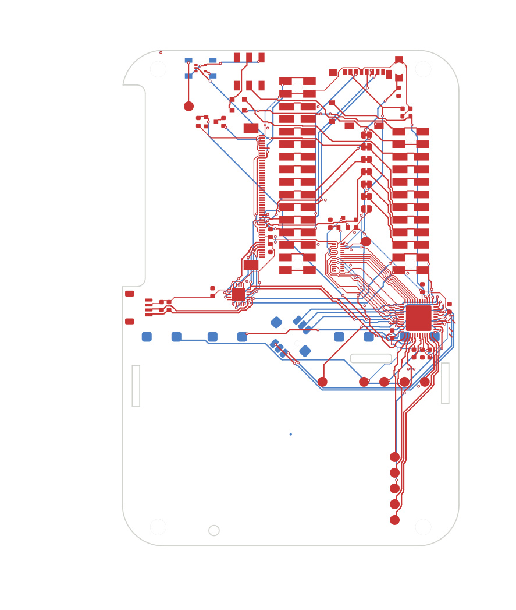

# Board Layout Bench

A mini benchmark with one task: **write a program that routes circuit boards, judged on boards it has never seen.**

Routing is drawing the copper tracks that join the parts on a board. A board works only when every connection (a "net") is made and no design rule is broken.

| The hardest hidden board, as a program gets it | The same board from the reference router |
|---|---|
|  |  |

**Result.** `claude-opus-5` and `claude-opus-5-5` each made four attempts through Harbor. All eight wrote a working router. None finishes the four hidden boards: the averages are 0.70 and 0.80 out of 1. A reference router finishes all four, so the top score is reachable.

## 1. Capability and motivation

- **Skill:** building a complete tool that works unattended on cases it has never seen.
- **Why it matters:** agents mostly write tools that run later without them. A program scored on unseen boards cannot be patched afterwards.
- **Gap:** board layout is measured and unsolved. Anthropic's [electronics post](https://www.anthropic.com/research/claude-electronics-design) reports 69% on Diode's PCB Gym for Claude Fable 5.2. [PCBWorld](https://arxiv.org/abs/2607.05915) and [PCBRouteAgent](https://arxiv.org/abs/2611.08175) score one board at a time and supply a routing tool. Here the agent gets only a shell, and its program is scored on boards it never saw.

## 2. Tasks and inputs

- **The job:** write a program that routes any board it is given, and test it on the practice boards.
- **Four practice boards:** real open-hardware KiCad boards with 30 to 110 nets. Every part is placed and every track is removed.
- **Each board's rules:** its project file, plus a rules file derived from the designer's layout. That file sets a minimum track width per net and a maximum length difference for matched pairs.
- **Tools:** KiCad 9 (command line and Python module), Python, numpy, and `boardcheck`, the grader's own checker.
- **Limits:** 75 minutes, 2 CPUs, 4 GB, no network beyond the model API.

The prompt is [instruction.md](tasks/route-unseen-boards/instruction.md).

## 3. Expected outputs

- **One file,** `/home/agent/work/router/route.py`, run as `python3 route.py <unrouted board> <routed board>`.
- **Four hidden boards** with 38 to 83 nets. Each run gets 8 minutes on 2 CPUs with no network.
- **Success** is a score of 1.0: every net on all four boards connected, with no rule broken.

## 4. Scoring and validity

- **Deterministic, no LLM judge.** The judge is KiCad's design-rule check, the check an engineer runs before ordering a board.
- **Board score:** nets that are fully connected and free of violations, divided by nets that needed routing. Breaking a net that was already connected takes one off. The task score is the average of the four boards.
- **Why it reflects the skill:** the program runs alone on boards the agent never saw, so only what the tool finishes by itself counts. Any correct layout is accepted; none is compared with a reference layout.
- **Leakage:** the hidden boards exist only in the verifier image. The program runs there as an unprivileged user without network, and only tracks and vias are read from its output.
- **Tested grader:** 11 to 14 checks per board, all passing.
- **Shortcuts,** scored by the same verifier:

| Submission | Score |
|---|---|
| Nothing handed in | 0.00 |
| Straight lines between pins | 0.04 |
| A program that never finishes | 0.00 |
| A program that tries to write its own score | 0.00 |

## 5. Coverage and difficulty

- **More instances:** any open-source KiCad board whose designer's layout passes the grader. [make_route_task.py](dev/kicad/make_route_task.py) strips the tracks and derives the rules. [package_unseen_task.py](dev/kicad/package_unseen_task.py) writes the task. Seventeen boards are pinned in [boards.tsv](dev/kicad/boards.tsv), with 30 to 323 nets and two to six copper layers.
- **Difficulty:** the number of copper layers, part density, matched pairs, time per board, and how far the hidden boards differ from the practice ones.
- **Why agents struggle:** the program has to finish alone. The last nets need earlier tracks taken out and routed again. And agents hand in before their own practice boards pass.

## Results

Every run uses the `claude-code` harness, launched through Harbor on local Docker. Each model made four attempts. An attempt number links to its transcript.

| Model | Attempt | Score | Main failure or finding |
|---|---|---|---|
| `claude-opus-5` | [1](results/harbor/route-unseen-boards-opus-5/attempt-1/transcript.md) | 0.82 | Said the budget had run out after 22 of 75 minutes. No length matching. |
| `claude-opus-5` | [2](results/harbor/route-unseen-boards-opus-5/attempt-2/transcript.md) | 0.50 | Handed in a program with a known connection bug after 42 minutes. 110 of 257 nets open. |
| `claude-opus-5` | [3](results/harbor/route-unseen-boards-opus-5/attempt-3/transcript.md) | 0.72 | 0.89 on its practice boards, 0.72 on the hidden ones. |
| `claude-opus-5` | [4](results/harbor/route-unseen-boards-opus-5/attempt-4/transcript.md) | 0.75 | Tracks too close to neighbouring pads: 99 spacing violations on two boards. |
| `claude-opus-5-5` | [1](results/harbor/route-unseen-boards-opus-5-5/attempt-1/transcript.md) | 0.89 | Best attempt: one board complete, and 2, 4 and 25 nets short on the others. Stopped with 47 minutes unused. |
| `claude-opus-5-5` | [2](results/harbor/route-unseen-boards-opus-5-5/attempt-2/transcript.md) | 0.78 | 0.95 on its practice boards, 0.78 on the hidden ones. |
| `claude-opus-5-5` | [3](results/harbor/route-unseen-boards-opus-5-5/attempt-3/transcript.md) | 0.79 | Stopped after 18 minutes with length matching listed as "Not handled yet". |
| `claude-opus-5-5` | [4](results/harbor/route-unseen-boards-opus-5-5/attempt-4/transcript.md) | 0.73 | 73 vias a millionth of a millimetre under the minimum size cost 28 nets on one board. |

**Findings**

- **No program finishes all four boards.** Of 32 board runs (8 programs on 4 boards), only 4 are complete: `cpld-test-board`, by each `claude-opus-5-5` program.
- **Most of the shortfall is an unfinished tool.** The eight programs average 0.84 on their own practice boards, and none completes them. On the hidden boards they average 0.75, so unseen boards cost a further 0.09.
- **The same nets fail.** Power and ground nets fail 61% of the time, and nets that leave a pad barely wider than the track fail 38%, against 6% for the rest ([counts](results/which-nets-fail.json)). On one board a copper area already joined ground, and all eight programs cut it.
- **Agents stop early.** All eight handed in by choice after 18 to 57 of 75 minutes. Seven never checked the time.
- **Writing the tool is harder than doing the job.** In a control kept out of this repository, `claude-opus-5-5` routed one practice board directly and completed it 4 times out of 4. Its four routers score 0.67 to 0.89 on that board.

**Is the low score caused by the task?**

- **Solvable:** the reference router completes all four hidden boards in 10 to 211 seconds each, of 480 allowed.
- **Working setup:** all eight attempts ran to the end. Through Harbor the reference scores 1.0 and handing in nothing scores 0.0.
- **Clear instructions:** every design rule the grader checks is in the prompt or the board's files, and the grader's checker is in the container.
- **Reasonable budget:** no agent used its 75 minutes and no program reached the 8-minute limit.

## Run it

Docker and [Harbor](https://www.harborframework.com/docs/tasks) are needed.

```bash
uv tool install harbor
harbor run -p tasks/route-unseen-boards -a oracle -y      # the reference router: 1.0
harbor run -p tasks/route-unseen-boards -a claude-code -m claude-opus-5 -k 4 -n 4 -y --env-file .env --agent-setup-timeout-multiplier 6
```

The last command makes four attempts and reads `ANTHROPIC_API_KEY` from `.env`. The results above came from the same run, signed in with a Claude Code OAuth token instead ([run_models.sh](dev/kicad/run_models.sh)).

## Repository

| Path | Contents |
|---|---|
| [tasks/route-unseen-boards/](tasks/route-unseen-boards/) | The task in Harbor format. `solution/router/route.py` is the reference router |
| `results/harbor/<job>/attempt-N/` | `transcript.md`, `trajectory.json`, `reward.json`, the verifier's reports, the handed-in `router/` and its scores on the practice boards |
| [results/reference-router/](results/reference-router/) | The reference router's verifier and Harbor runs |
| [dev/kicad/](dev/kicad/) | The grader (`boardcheck.py`) and its tests, and the packaging, run and analysis scripts |

## Limitations

- **Small:** four hidden boards, four attempts per model, and overlapping ranges (0.50 to 0.82 and 0.73 to 0.89).
- **Reference router:** written after the runs by Claude Code with a newer model (Claude Fable 5.2), in about 70 minutes, with the hidden boards in view. It shows that 1.0 is reachable in the time allowed, not that a program written blind in 75 minutes can reach it.
- **Practice and hidden boards differ:** 48% of the hidden nets leave a pad barely wider than the track, against 9% of the practice nets. That explains part of the gap between 0.84 on the practice boards and 0.75 on the hidden ones.
- **Time-outs:** 75 minutes for the agent plus up to 53 for scoring. Real trials took 54 to 102 minutes, 28 of them Harbor installing Claude Code.

## Next steps

- Show the agent a clock, to separate "cannot finish" from "stopped early".
- Test the reference router on boards it has never seen, and add a tight-pad board to the practice set.
- Use harder hidden boards with four and six copper layers, which are already in `boards.tsv`.

## Time spent

About 5 hours of hands-on time.
